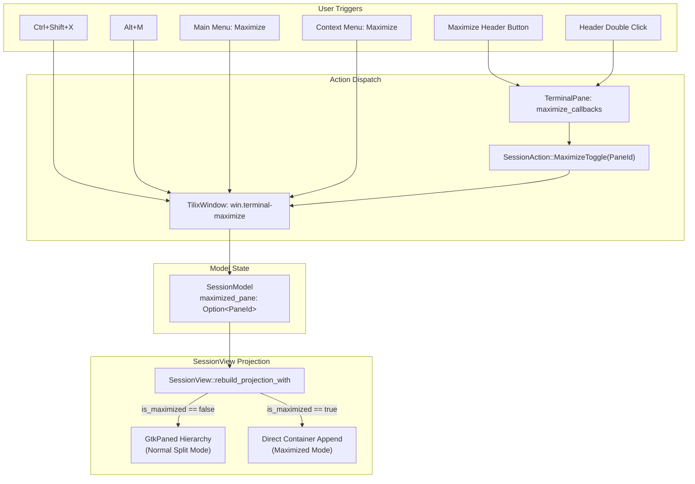

# Master Specification: Phase 19 — Terminal Pane Maximize Toggle & Upstream Parity

- **Document ID:** `SPEC-0019`
- **Date:** 2026-10-24
- **Status:** Proposed / Ready for Execution
- **Workflow Level:** Medium/Large (Phase 19 of Tilix Rewrite)
- **Preceding Specifications:**
  - [`docs/specs/spec-0001-rust-tilix-foundation-2026-09-15.md`](file:///playground/tilix/docs/specs/spec-0001-rust-tilix-foundation-2026-09-15.md) through [`docs/specs/spec-0018-osc8-hyperlinks-2026-09-22.md`](file:///playground/tilix/docs/specs/spec-0018-osc8-hyperlinks-2026-09-22.md)
- **Target Location:** `/playground/tilix`

---

## 1. Context & Motivation

### 1.1 The Problem: Temporary Terminal Expansion in Multi-Pane Workflows
Tilix's tiling workflow allows power users to subdivide a session into rich arrangements of horizontal and vertical splits. In intensive development and administrative sessions—such as monitoring continuous log streams, running fullscreen ncurses/TUI interfaces (`htop`, `lazygit`, `k9s`, `neovim`), or reading wide tabular database output—the screen area allotted to a single split pane can become temporarily insufficient.

In Gerald Nunn's original upstream Tilix (D/GTK3), this was solved via **Pane Maximization**:
1. Users could toggle maximize on any terminal pane using keyboard shortcuts (`Ctrl+Shift+X` or `Alt+M`), by clicking a dedicated maximize/restore button in the pane header bar, double-clicking the pane header bar, selecting "Maximize Terminal" from the right-click context menu, or choosing it from the main application hamburger menu.
2. When maximized, the selected terminal temporarily expanded to occupy the entire tab viewport, completely obscuring peer split panes.
3. Critically, hidden peer terminals were **not** terminated or paused: their child shells and background commands continued running without interruption.
4. When toggled off ("restored"), the original split geometry and exact separator proportions were restored without layout corruption or aspect ratio drift.
5. If only a single terminal existed in the session, maximize was disabled as a no-op since the pane already occupied 100% of the viewport.
6. If a maximized terminal was split, or peers were closed until only one remained, Tilix smoothly returned to normal layout mode.

### 1.2 Current State in Tilix Rust
In the current Tilix Rust implementation:
- `SessionModel` lacks any maximize state tracking (`maximized_pane`).
- `ACTION_CATALOG` does not define `win.terminal-maximize`, and default shortcuts `<Primary><Shift>x` and `<Alt>m` are unmapped.
- `TerminalPane` header lacks a maximize button and double-click toggle gesture.
- `TerminalPane` context menu lacks a "Maximize Terminal" option.
- `SessionView::rebuild_projection_with` unconditionally projects the entire `Paned` tree, offering no bypass mechanism to project a single pane directly into the root container.
- If `rebuild_projection_with` were to mount a single pane without precautions, `capture_ratios_recursive` would fail or destroy existing tree ratios.
- `TilixWindow` does not register `win.terminal-maximize` or expose it in the application hamburger menu.

Phase 19 provides full upstream parity for the terminal pane maximize toggle functionality across the headless domain model, keybindings catalog, terminal pane UI, session projection reconciler, and window action menus.

---

## 2. Upstream Tilix Alignment

In upstream Tilix (`source/gx/tilix/terminal/terminal.d`, `source/gx/tilix/session.d`, and `source/gx/tilix/window.d`):
1. **Action Identification & Accelerators:** Upstream Tilix registered action `"app.terminal-maximize"` (mapped at the window level) with default shortcuts `<Primary><Shift>x` and `<Alt>m`.
2. **Session Projection Bypass:** Upstream Tilix swapped the active container child: when maximized, the single terminal was attached directly to the session viewport container; when unmaximized, the root `GtkPaned` container was reattached.
3. **Split Ratio Invariant:** Split positions were retained in memory so that restoring never drifted child dimensions.
4. **Header Bar Controls:** The pane header displayed a maximize icon (`view-fullscreen-symbolic`) which transformed into a restore icon (`view-restore-symbolic`) when maximized. Double-clicking the header bar triggered maximize toggle.
5. **Context Menu & Main Menu:** Both the terminal context menu and window header hamburger menu exposed "Maximize Terminal" / "Restore Terminal".
6. **Single Pane Invariant:** Sessions with 1 pane kept the maximize button insensitive (disabled).

Phase 19 mirrors this architecture in Tilix Rust using GTK4 event controllers, pure headless model state, and non-destructive widget reparenting.

---

## 3. Amended Documents & Scope

- **Amended Living Architecture:** [`docs/architecture/overview.md`](file:///playground/tilix/docs/architecture/overview.md)
- **Status of Living Architecture:** Active (Version bumped to 0.19.0 with Section 31 documenting Terminal Pane Maximize Toggle & Upstream Parity)

### 3.1 Affected Scope

1. **`src/model/session.rs`:**
   - Add field `#[serde(default)] pub maximized_pane: Option<PaneId>` to `SessionModel`.
   - Implement `is_maximized(&self) -> bool`.
   - Implement `maximized_pane(&self) -> Option<PaneId>`.
   - Implement `toggle_maximize(&mut self, target: Option<PaneId>) -> bool`.
   - Implement `unmaximize(&mut self) -> bool`.
   - Update `remove_pane(&mut self, id: PaneId)`: clear maximize if the closed pane was maximized or if remaining `leaf_count() <= 1`.
   - Update `split_pane`, `dock_pane`, and `adopt_pane`: automatically unmaximize (`maximized_pane = None`).
   - Add comprehensive unit tests in `src/model/session.rs`.
2. **`src/model/keybindings.rs`:**
   - Add `win.terminal-maximize` to `ACTION_CATALOG` in `ActionCategory::SplitsAndLayout`:
     - ID: `"win.terminal-maximize"`
     - Title: `"Maximize Terminal"`
     - Description: `"Toggle maximize active terminal pane"`
     - Category: `ActionCategory::SplitsAndLayout`
     - Default accelerators: `&["<Primary><Shift>x", "<Alt>m"]`
3. **`tests/test_phase7_keybindings.rs`:**
   - Update catalog length assertion from 33 to 34.
   - Update `split_actions.len()` from 4 to 5.
   - Assert presence of `win.terminal-maximize` and its default accelerators.
4. **`tests/test_phase14_osc52_and_clipboard.rs`:**
   - Update catalog length assertion from 33 to 34.
5. **`src/ui/terminal_pane.rs`:**
   - Add `maximize_btn: gtk::Button`, `is_maximized: Rc<Cell<bool>>`, and `maximize_callbacks: Rc<RefCell<Vec<MaximizeToggleCallback>>>` to `TerminalPane`.
   - Insert `maximize_btn` in the pane header before `close_btn`.
   - Wire `maximize_btn.connect_clicked` and header double-click gesture (`gtk::GestureClick` with `n == 2`) to fire maximize callbacks.
   - Implement public methods: `set_maximized(&self, bool)`, `is_maximized(&self) -> bool`, `set_maximize_sensitive(&self, bool)`, `connect_maximize_toggle(&self, F)`, and `clear_callbacks(&self)`.
   - Update `build_context_menu(has_link: bool)` to include `"Maximize Terminal"` (`win.terminal-maximize`) in `split_section`.
6. **`src/ui/session_view.rs`:**
   - Add `SessionAction::MaximizeToggle(PaneId)`.
   - Connect `pane.connect_maximize_toggle` in `wire_pane_callbacks` to emit `SessionAction::MaximizeToggle`.
   - In `rebuild_projection_with`:
     - Guard `capture_ratios_recursive` so it only executes when `!model.borrow().is_maximized()`.
     - When `maximized_pane` is `Some(id)`: mount `max_pane.widget()` directly to `container`, skipping `Paned` creation.
     - When `None`: build standard `Paned` hierarchy.
     - Update all panes via `pane.set_maximized(*pane_id == max_id)` and grab focus on active pane.
   - In `update_pane_headers_visibility`:
     - Ensure header is visible when maximized (unless `PaneTitleStyle::None`).
     - Update `maximize_btn.set_sensitive(count > 1 || is_maximized)`.
   - Expose session convenience methods: `toggle_maximize`, `toggle_maximize_active`, `is_maximized`, `unmaximize`.
7. **`src/ui/window.rs`:**
   - Register `win.terminal-maximize` in `TilixWindow::setup_actions`, dispatching to `active_session().toggle_maximize_active()`.
   - In `setup_actions`, connect `SessionAction::MaximizeToggle(id)` to `session.borrow().toggle_maximize(Some(id))`.
   - Append "Maximize Terminal" to `app_menu` in the window header bar next to "Balance Layout".
8. **`src/ui/quake.rs`:**
   - Register `win.terminal-maximize` on `TilixQuakeWindow` and handle `SessionAction::MaximizeToggle` in dropdown session action handler.
9. **`docs/architecture/overview.md`:**
   - Update version to 0.19.0 and document Section 31.
10. **`tests/test_phase19_pane_maximize.rs` (New Integration Suite):**
   - Headless unit & integration tests covering model lifecycle, ratio retention, catalog integrity, widget projection, Quake action registration, focus navigation guard, and menus.

### 3.2 Unaffected Scope

- `src/pty/*`: Child process execution and PTY streaming are completely decoupled from UI layout projection; terminals continue running unmodified while hidden.
- `src/model/layout.rs`: Split layout math and balance algorithms remain unchanged.
- `src/model/profile.rs`: Profile options remain unchanged.
- `src/ui/dnd.rs`: Drag & drop docking math remains unchanged.

---

## 4. Requirements, Goals & Non-Goals

### Goals

1. **Full Upstream Keybinding Parity:**
   - Provide `win.terminal-maximize` with default accelerators `<Primary><Shift>x` (`Ctrl+Shift+X`) and `<Alt>m` (`Alt+M`).
   - Zero keybinding collisions with existing actions in `ACTION_CATALOG`.
2. **Domain Model Purity & Serde Roundtripping:**
   - Track maximize state in `SessionModel` (`maximized_pane: Option<PaneId>`) with Serde backward compatibility.
   - Single-pane safety guard: maximize is a no-op when `leaf_count() <= 1`.
3. **Flawless Layout Ratio Preservation:**
   - Never overwrite or corrupt split ratios when transitioning into or out of maximized mode.
4. **Header Controls & Gestures:**
   - Dedicated header button that dynamically displays `"view-fullscreen-symbolic"` (unmaximized) or `"view-restore-symbolic"` (maximized).
   - Double-clicking the pane header bar toggles maximize/restore.
   - Header button is sensitive only when `leaf_count() > 1` or when currently maximized.
5. **Context Menu & Main Menu Integration:**
   - Terminal right-click context menu includes "Maximize Terminal" (`win.terminal-maximize`).
   - Header bar hamburger menu includes "Maximize Terminal" (`win.terminal-maximize`).
6. **Graceful Degradation & Fallbacks:**
   - Splitting a maximized pane automatically unmaximizes the session so both panes are visible.
   - Closing a maximized pane automatically unmaximizes and smoothly falls back to remaining panes.
   - Docking/adopting another pane automatically unmaximizes.

### Non-Goals

- Maximizing across multiple tabs or windows (maximize is strictly scoped to the active session tab).
- Custom animations/transitions (immediate projection maintains Tilix's fast, low-latency terminal feel).
- Freezing background terminal processes (background panes must continue executing shell tasks).

---

## 5. Architectural Design & Detailed Decisions

### 5.1 Decision Gating: Facts, Decisions, Assumptions, Deferred Items

- **Facts:**
  - Upstream Tilix exposes maximize via `Ctrl+Shift+X` and `Alt+M`.
  - In GTK4, a widget can only have a single parent. Re-attaching a widget requires detaching it from its current parent (`Paned` or `Box`).
  - `ACTION_CATALOG` currently contains 33 items; `tests/test_phase7_keybindings.rs` and `tests/test_phase14_osc52_and_clipboard.rs` enforce this exact length.
  - In `SessionView`, `capture_ratios_recursive` calculates ratios from `GtkPaned` sizes. If executed while maximized, `container.first_child()` is a single `TerminalPane`, which would fail to find `GtkPaned` nodes.
- **Decisions:**
  - **Single Pane Invariant:** Disallow maximizing when `layout.leaf_count() <= 1`. Return `false` and do not alter state.
  - **Ratio Guarding:** In `SessionView::rebuild_projection_with` and `capture_layout_ratios`, explicitly guard against ratio capture if `model.borrow().is_maximized()`.
  - **Widget Reparenting:** When maximized, detach the maximized pane from any existing parent and append directly to `SessionView::container`. Peer panes remain in the `panes` HashMap, continuing to receive background PTY data, but their widgets are unparented from GTK layout pass.
  - **Restore Synchronization:** When toggling unmaximize, `rebuild_projection_with` rebuilds the `Paned` tree from `model.layout.root()`, restoring exact split proportions.
  - **Header Double-Click:** Attach `gtk::GestureClick` to `TerminalPane::header` with `set_button(gtk::gdk::BUTTON_PRIMARY)`. On `n_press == 2`, invoke maximize callbacks.
- **Assumptions:**
  - Standard GNOME icon themes provide `"view-fullscreen-symbolic"` and `"view-restore-symbolic"`.
- **Deferred Items:**
  - Custom animation transitions between splits and maximized state.

---

### 5.2 Architecture Data Flow



---

### 5.3 Domain Model Specification (`src/model/session.rs`)

`SessionModel` is updated with `maximized_pane`:

```rust
#[derive(Debug, Clone, PartialEq, Serialize, Deserialize)]
pub struct SessionModel {
    pub layout: LayoutTree,
    pub active_pane: Option<PaneId>,
    pub sync_groups: HashMap<PaneId, SyncGroupId>,
    #[serde(default)]
    pub sync_input_enabled: bool,
    #[serde(default)]
    pub pane_sync_overrides: HashMap<PaneId, bool>,
    #[serde(default)]
    pub focus_history: Vec<PaneId>,
    #[serde(default)]
    pub maximized_pane: Option<PaneId>,
    next_pane_id: u64,
}
```

#### Transition Invariants:
1. `is_maximized(&self) -> bool`: returns `self.maximized_pane.is_some()`.
2. `maximized_pane(&self) -> Option<PaneId>`: returns `self.maximized_pane`.
3. `toggle_maximize(&mut self, target: Option<PaneId>) -> bool`:
   - If `self.layout.leaf_count() <= 1`, returns `false`.
   - If currently maximized:
     - If `target` is `None` or matches `self.maximized_pane`, sets `self.maximized_pane = None` and returns `false`.
     - If `target` is `Some(id)` where `id != current`, switches `self.maximized_pane = Some(id)`, records focus on `id`, and returns `true`.
   - If not currently maximized:
     - Sets target to `target.or(self.active_pane)`.
     - If target exists in `self.layout`: sets `self.maximized_pane = Some(target)`, records focus, and returns `true`.
     - Otherwise returns `false`.
4. `unmaximize(&mut self) -> bool`:
   - If `self.maximized_pane.is_some()`, sets `self.maximized_pane = None` and returns `true`.
   - Otherwise returns `false`.
5. In `split_pane`:
   - Automatically unmaximizes (`self.maximized_pane = None`).
6. In `remove_pane`:
   - If `self.maximized_pane == Some(id)` or remaining `leaf_count() <= 1`, resets `self.maximized_pane = None`.
7. In `dock_pane` and `adopt_pane`:
   - Automatically unmaximizes (`self.maximized_pane = None`).

---

### 5.4 Keybindings & Action Catalog (`src/model/keybindings.rs`)

Insert into `ACTION_CATALOG` under `ActionCategory::SplitsAndLayout`:

```rust
ActionShortcutDef {
    id: "win.terminal-maximize",
    title: "Maximize Terminal",
    description: "Toggle maximize active terminal pane",
    category: ActionCategory::SplitsAndLayout,
    default_accels: &["<Primary><Shift>x", "<Alt>m"],
},
```

Catalog count increases:
- Total actions: `33 -> 34`.
- Splits & Layout actions: `4 -> 5`.

---

### 5.5 Terminal Pane UI & Header Controls (`src/ui/terminal_pane.rs`)

1. **Header Layout:**
   Header buttons in order:
   - `sync_btn` (Input synchronization toggle)
   - `split_h_btn` (Split Right)
   - `split_v_btn` (Split Down)
   - `maximize_btn` (Maximize/Restore Toggle)
   - `close_btn` (Close Pane)
2. **Maximize Button Styling:**
   - Unmaximized: Icon `"view-fullscreen-symbolic"`, tooltip `"Maximize Terminal (Ctrl+Shift+X, Alt+M)"`.
   - Maximized: Icon `"view-restore-symbolic"`, tooltip `"Restore Terminal (Ctrl+Shift+X, Alt+M)"`, CSS class `"maximized"`.
3. **Double Click Gesture on Header:**
   ```rust
   let header_click = gtk::GestureClick::new();
   header_click.set_button(gtk::gdk::BUTTON_PRIMARY);
   let callbacks = Rc::clone(&maximize_callbacks);
   header_click.connect_pressed(move |_gesture, n_press, _x, _y| {
       if n_press == 2 {
           if let Ok(list) = callbacks.try_borrow() {
               for cb in list.iter() {
                   cb(pane_id);
               }
           }
       }
   });
   header.add_controller(header_click);
   ```
4. **Context Menu Item:**
   In `build_context_menu(has_link: bool)`:
   ```rust
   let split_section = gio::Menu::new();
   split_section.append(Some("Split Right"), Some("win.split-right"));
   split_section.append(Some("Split Down"), Some("win.split-down"));
   split_section.append(Some("Close Terminal"), Some("win.close-pane"));
   split_section.append(Some("Maximize Terminal"), Some("win.terminal-maximize"));
   menu.append_section(None, &split_section);
   ```

---

### 5.6 Session View Projection Reconciler (`src/ui/session_view.rs`)

1. **SessionAction Extension:**
   ```rust
   #[derive(Debug, Clone)]
   pub enum SessionAction {
       Split(PaneId, SplitOrientation),
       Close(PaneId),
       Focus(PaneId),
       MaximizeToggle(PaneId),
   }
   ```
2. **Rebuild Projection Logic:**
   - If `!model.borrow().is_maximized()`, capture current split ratios via `capture_ratios_recursive`.
   - Detach all pane widgets and clear container children.
   - If `let Some(max_id) = model.borrow().maximized_pane`:
     - Retrieve `panes.get(&max_id)`.
     - Set `hexpand = true`, `vexpand = true`, append widget directly to `container`.
   - Else:
     - Build standard `Paned` tree via `build_node(root_node, ...)` and append to `container`.
   - Update `pane.set_maximized(*pane_id == max_id)` on all panes.
   - Grab focus on the active pane.
3. **Header Visibility & Sensitivity:**
   - In `update_pane_headers_visibility`:
     - If `is_maximized` is true, ensure header is visible (unless `PaneTitleStyle::None`).
     - Set `pane.set_maximize_sensitive(count > 1 || is_maximized)`.

---

### 5.7 Window Actions & Menu Integration (`src/ui/window.rs`)

1. **Action Registration:**
   ```rust
   // Terminal Maximize Toggle
   {
       let action = gio::SimpleAction::new("terminal-maximize", None);
       let tab_view_weak = self.tab_view.downgrade();
       let sessions = Rc::clone(&self.sessions);
       action.connect_activate(move |_, _| {
           let Some(tv) = tab_view_weak.upgrade() else { return; };
           let Some(page) = tv.selected_page() else { return; };
           let session_opt = sessions.borrow().get(&page).cloned();
           if let Some(session) = session_opt {
               session.borrow().toggle_maximize_active();
               session.borrow().grab_focus();
               let s_weak = Rc::downgrade(&session);
               glib::idle_add_local_once(move || {
                   if let Some(s) = s_weak.upgrade() {
                       s.borrow().grab_focus();
                   }
               });
           }
       });
       self.window.add_action(&action);
   }
   ```
2. **Main Menu Integration:**
   In `header_bar` `app_menu`:
   ```rust
   let app_menu = gio::Menu::new();
   app_menu.append(Some("Quake"), Some("win.quake-toggle"));
   app_menu.append(Some("Balance Layout"), Some("win.balance-layout"));
   app_menu.append(Some("Maximize Terminal"), Some("win.terminal-maximize"));
   app_menu.append(Some("Preferences"), Some("win.preferences"));
   // ...
   ```

---

## 6. Integration & Edge Cases

1. **Single Pane Safeguard:**
   When `leaf_count() <= 1`, maximize is rejected in `SessionModel`, and the maximize header button is disabled (`sensitive = false`).
2. **Splitting While Maximized:**
   When a user splits a maximized terminal (`Ctrl+Shift+R` or `Ctrl+Shift+D`), `SessionModel::split_pane` resets `maximized_pane = None`. The view smoothly restores the split tree displaying both the existing pane and the new child pane.
3. **Closing Maximized Terminal:**
   Closing a maximized terminal resets `maximized_pane = None`, restoring the remaining panes to their normal layout with MRU focus.
4. **Docking and Pane Dragging:**
   Docking or adopting a pane resets `maximized_pane = None`.
5. **Layout Ratio Fidelity:**
   `capture_ratios_recursive` is explicitly bypassed while maximized, ensuring original user-configured or balanced ratios remain pristine.

---

## 7. Validation Plan

### Automated Test Suites
1. **Catalog & Regression Suites:**
   ```bash
   cargo test --test test_phase7_keybindings
   cargo test --test test_phase14_osc52_and_clipboard
   ```
2. **Dedicated Phase 19 Suite:**
   ```bash
   cargo test --test test_phase19_pane_maximize
   ```
3. **Full Repository Validation:**
   ```bash
   cargo test
   ```

### Manual Verification Matrix
1. **Split & Maximize:** Create a 3-pane split layout. Press `Ctrl+Shift+X` or `Alt+M`. Verify the active pane expands to full window size, and header icon becomes `view-restore-symbolic`.
2. **Double-Click Restore:** Double-click the header bar. Verify the layout restores to original proportions.
3. **Split While Maximized:** Maximize a pane, then press `Ctrl+Shift+R`. Verify view automatically unmaximizes and shows the new split.
4. **Single Pane Invariant:** On a fresh single-pane tab, verify maximize button is disabled and pressing `Ctrl+Shift+X` does nothing.
5. **Context Menu & Hamburger Menu:** Right-click terminal to verify "Maximize Terminal" works; click window hamburger menu to verify "Maximize Terminal" works.
